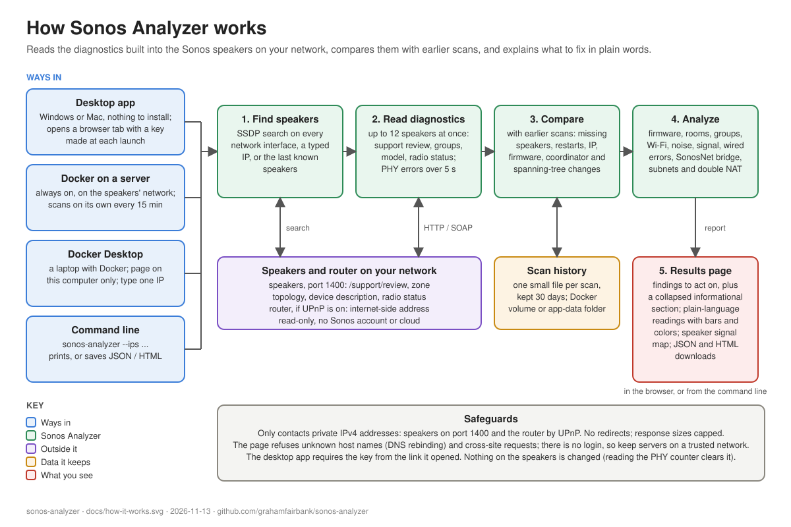

# Sonos Analyzer

Analyze Sonos speakers on your local network — firmware, connectivity, stereo-pair topology, Wi-Fi vs Ethernet issues, and practical recommendations.

This is a fork of [soinkleined/sonos-analyzer](https://github.com/soinkleined/sonos-analyzer) by David Klein, which provides the original command-line analyzer. The fork adds a web UI, a Docker image and deeper analysis; see [Changes from the original](#changes-from-the-original).

Uses the same diagnostic endpoints Sonos exposes locally (`/support/review`, UPnP zone topology). **No cloud account required.** Your speakers must be reachable on the same network as the machine running this tool.



## Get started

Pick the setup that matches what you have:

| You have | Do this | Time |
|---|---|---|
| **A Windows or Mac laptop, nothing installed** | Download the ready-made desktop app, open it, and it opens in your browser. Discovery works. Prefer code you can inspect? The same page shows how to run the identical app from source with Python. See **[Desktop app for Windows and Mac](docs/desktop-app.md)**. | About 5 minutes |
| **A Windows or Mac laptop with Docker Desktop** | Install Docker Desktop, then run one command. See **[Run on a laptop with Docker Desktop](docs/docker-desktop.md)** for the easy route (ready-built image) or the inspect-the-code route (build it yourself). | About 15 minutes, mostly installing Docker Desktop |
| **A Linux server, NAS or Raspberry Pi** on the speakers' network | Follow [Quick start with Docker](#quick-start-with-docker) below. Speakers are discovered automatically. | About 5 minutes |
| **Python 3.10+** and no Docker | Follow [Install with Python](#install-with-python). | About 2 minutes |

The quickest way to try it on any machine with Docker:

```bash
docker run -d --name sonos-analyzer -p 127.0.0.1:8400:8400 -v sonos-analyzer-data:/data -e SONOS_ANALYZER_SCAN_INTERVAL=0 --restart unless-stopped ghcr.io/grahamfairbank/sonos-analyzer:latest
```

Then open http://localhost:8400, type one speaker's IP address and press **Scan network**. The ready-built image is made by GitHub Actions from the tagged source of each release, for Intel/AMD and ARM.

## Quick start with Docker

For a server that stays on the speakers' network, with automatic discovery. (No server? See [Run on a laptop with Docker Desktop](docs/docker-desktop.md).) You need a Linux machine on the same network as your speakers, with [Docker Engine](https://docs.docker.com/engine/install/) and the Compose plugin (`docker compose version` should print a version).

```bash
git clone https://github.com/grahamfairbank/sonos-analyzer.git
cd sonos-analyzer
docker compose up -d --build
```

Then open `http://<address-of-that-machine>:8400` and press **Scan network**. A scan takes about 10 seconds.

Check that it started:

```bash
docker compose ps        # STATUS should show "healthy"
docker compose logs -f   # request log; Ctrl+C to stop following
```

### Day-to-day

| Task | Command |
|---|---|
| Stop | `docker compose down` |
| Start again | `docker compose up -d` |
| Update to the latest version | `git pull && docker compose up -d --build` |
| Remove completely | `docker compose down --rmi local -v` (also deletes the scan history volume) |

The container restarts automatically after a reboot or crash unless you stopped it yourself.

### Settings

Set these under `environment:` in `docker-compose.yml`, then run `docker compose up -d` again.

| Variable | Default | Purpose |
|---|---|---|
| `SONOS_ANALYZER_PORT` | `8400` | Port the web UI listens on |
| `SONOS_ANALYZER_INTERFACE` | all interfaces | Limit speaker discovery to one interface, by name (`eth0`) or IPv4 address |
| `SONOS_ANALYZER_HOST` | `0.0.0.0` | Address the web UI binds to; set it to one of the host's addresses to serve the UI on that network only |
| `SONOS_ANALYZER_ALLOWED_HOSTS` | none | Host names you open the page by, comma-separated (for example `nas.home.lan`). IP addresses, `localhost`, `.local` names and the machine's own name always work; other names are refused to block DNS-rebinding attacks. With Compose, put it in a `.env` file next to `docker-compose.yml`. Behind a reverse proxy (including one that serves the page over `https://`), add the name you browse to, and make sure the proxy passes that name on in the `Host` header. |
| `SONOS_ANALYZER_SCAN_INTERVAL` | `15` | Minutes between background scans, which catch restarts, missing speakers and other changes between your own scans; `0` turns them off. When discovery finds nothing (Docker Desktop), background scans reuse the speakers from the last scan. |
| `SONOS_ANALYZER_ROUTER_CHECK` | `1` | `0` stops the analyzer asking your router (by UPnP, on the local network) for its internet-side address, which is how it spots double NAT. |
| `SONOS_ANALYZER_DATA` | `/data` in the image | Folder for scan history: one small JSON file per scan, kept 30 days. The `docker run` and Compose examples keep it in the `sonos-analyzer-data` volume so it survives updates; if you mount a folder instead, it must be writable by user `nobody` (UID 65534). Clear it from the page with **Clear history**. |

### Without Compose

Using the ready-built image:

```bash
docker run -d --name sonos-analyzer --network host -v sonos-analyzer-data:/data --restart unless-stopped ghcr.io/grahamfairbank/sonos-analyzer:latest
```

Or build it yourself from the source:

```bash
docker build -t sonos-analyzer .
docker run -d --name sonos-analyzer --network host -v sonos-analyzer-data:/data --restart unless-stopped sonos-analyzer
```

Add `-e SONOS_ANALYZER_PORT=9000` (or any other setting above) before the image name to change a setting.

### Why host networking, and macOS / Windows

The container uses the host's network directly (`network_mode: host`) rather than a published port. Speaker discovery relies on multicast, which does not cross Docker's default bridge network. This works on Linux.

Docker Desktop on macOS and Windows runs containers inside a virtual machine, so discovery finds nothing there. **On a Windows or Mac laptop, follow [Run Sonos Analyzer on a laptop with Docker Desktop](docs/docker-desktop.md)**: it uses `docker-compose.desktop.yml`, which publishes the UI on `http://localhost:8400`, and you type one speaker's IP address instead of using discovery.

### Troubleshooting

- **"No Sonos speakers discovered"**: the host is probably not on the speakers' network (a different VLAN or subnet), or the network blocks multicast. Enter one speaker's IP in the UI; a single speaker describes the whole household. Find IPs in the Sonos app under Settings > System > About My System.
- **"Could not read diagnostics from any speaker"**: discovery worked but the host cannot open TCP port 1400 on the speakers. Check routing and firewall rules between the two networks.
- **"This page cannot be opened as …"**: you opened the page by a host name the analyzer doesn't know. Open it by IP address, or add the name to `SONOS_ANALYZER_ALLOWED_HOSTS` (see [Settings](#settings)).
- **"Cross-origin requests are not allowed" behind a reverse proxy**: the proxy is changing the `Host` header, so it no longer matches the address in your browser. Configure the proxy to pass the original host name through (for example `proxy_set_header Host $host;` in nginx; HAProxy passes it by default).
- **The page does not load**: check `docker compose ps`, that nothing else uses port 8400 (`ss -ltn | grep 8400`), and that the host's firewall allows the port.
- **The UI has no login.** Anyone who can reach the port can run scans, so keep it on a trusted LAN and do not expose it to the internet. It only probes private IPv4 addresses and never changes speaker settings.

## Install with Python

Requires Python 3.10+; there are no third-party dependencies.

```bash
git clone https://github.com/grahamfairbank/sonos-analyzer.git
cd sonos-analyzer
pip install .
```

Or run from the checkout without installing:

```bash
python -m sonos_analyzer
```

## Command-line usage

Discover speakers automatically (SSDP):

```bash
sonos-analyzer
```

Target specific IPs (useful if discovery is blocked):

```bash
sonos-analyzer --ips 192.168.1.165,192.168.1.89,192.168.1.193
```

Write reports:

```bash
sonos-analyzer --json report.json --html report.html
```

Quiet mode (files only):

```bash
sonos-analyzer --ips 192.168.1.165 --json report.json --html report.html --quiet
```

On Linux, discovery is sent on every network interface and `--interface eth0` limits it to one. On Windows and macOS it uses the default network route, and `--interface` takes an IPv4 address. `--phy-sample 0` skips the Wi-Fi error-rate measurement for a faster scan. `--no-router-check` skips the network checks that ask the router for its internet-side address and note which address this computer uses.

## Web UI without Docker

```bash
sonos-analyzer-web --host 0.0.0.0 --port 8400
```

Then open `http://<host>:8400`. Leave the IP field empty to auto-discover, or enter speaker IPs. The page shows the speakers, findings, channel map and signal matrix, and lets you download the JSON and HTML reports. By default it binds to `127.0.0.1` only.

## What it checks

- Speaker inventory grouped by room: stereo pairs and home theater sets (soundbar, surrounds, subs) are shown as one room with each speaker's role
- Bonded rooms: mixed wired + wireless stereo pairs, pairs split across Wi-Fi channels, satellites not on the soundbar's own link, surround link overlapping your Wi-Fi
- Firmware: per-version breakdown by model, speakers that are behind others of the same model, and bonded speakers on mismatched versions
- Radio channel map: which speakers use which band and channel, and for what (home Wi-Fi, home theater link, SonosNet, unused)
- Wi-Fi quality: PHY error rate measured over a short window (`--phy-sample`), outliers against the rest of the household, noise floor, 2.4 GHz overlapping channels, DFS channels, extenders
- Wired checks: radio left on for wired speakers, slow or half-duplex Ethernet links, interface error ratios, bridge RX drops, SonosNet / spanning-tree state
- Speaker-to-speaker signal: how strongly each speaker's radio hears every other one (the data behind Sonos's own network matrix), shown in the web UI as a link diagram and a matrix
- Trueplay tuning state per room (portables, Port, Boost and Amp are left out)
- Group coordinator: groups led by a speaker on a noisy or older radio when a wired or better-placed member could lead them
- Older Wi-Fi radios: models Sonos documents without WPA3, so a router change keeps WPA2 available
- Network layout: speakers on a different subnet from the rest, and this computer on a different subnet from the speakers (Sonos requires the app and all speakers on one subnet). Home theater surrounds' wider netmask on the soundbar link is not counted as a split
- Double NAT: if your router answers UPnP, it is asked for its internet-side address; a private address means another router sits in front of it, and 100.64.x means your provider shares its public address (both informational). Routers with UPnP off don't answer, and then nothing is reported. A public address is never shown or stored
- Monitoring (server): background scans every 15 minutes and 30 days of history, reporting missing speakers, unexpected restarts, firmware updates, IP, group coordinator and spanning-tree root changes, and network errors since the last scan
- Plain-language readings: bars, words and colors for noise floor, signal and PHY errors, using the bands of Sonos's own network matrix where it has them
- Related issues are reported as one finding listing every affected speaker, with actionable recommendations

## Limitations

- Must run on the **same LAN** as your Sonos system
- Some networks block SSDP multicast — enter speaker IPs (`--ips` or the UI field) if discovery finds nothing
- Diagnostics are read-only; the tool does not change Sonos settings
- Findings are heuristic guidance, not official Sonos support output

## Example

```bash
sonos-analyzer --ips 192.168.1.165,192.168.1.89,192.168.1.193 \
  --json sonos-report.json \
  --html sonos-report.html
```

## Security and reviews

The analyzer only reads from speakers, and only contacts private IPv4 addresses: speakers on port 1400, and the router, if it answers a UPnP search, to ask for its internet-side address (`--no-router-check` or `SONOS_ANALYZER_ROUTER_CHECK=0` turns that off). It never follows redirects. The web UI has no login: on a server, keep it on a trusted LAN; the desktop app and the Docker Desktop setup only listen on the computer itself.

To report a security problem privately, see [SECURITY.md](SECURITY.md).

Independent reviews and what was done about each finding:

- [2026-11-13: Fable review of the 0.4.0 release candidate](docs/reviews/2026-11-13-fable-review.md), fixed in 0.4.0
- [2026-11-12: Fable review of v0.4.0-beta.1](docs/reviews/2026-11-12-fable-review.md), fixed in v0.4.0-beta.2

## Running the tests

The tests use only the Python standard library and a made-up household, so they need no speakers or network:

```bash
python3 -m unittest discover -s tests -t .
```

## Changes from the original

See [CHANGELOG.md](CHANGELOG.md) for each release. Based on [soinkleined/sonos-analyzer](https://github.com/soinkleined/sonos-analyzer) 0.1.0. This fork adds:

- A web UI (`sonos-analyzer-web`) and a Docker image / compose file
- Rooms: stereo pairs and home theater sets grouped with roles, and checked as a unit
- Measured Wi-Fi PHY error rates, a radio channel map and a speaker-to-speaker signal matrix
- Wired checks, per-model firmware comparison, and findings grouped per issue
- Discovery on every network interface (Linux), and scans roughly five times faster on large households
- A ready-built multi-architecture image on GitHub Container Registry, and a Docker Desktop guide for laptops
- Fixes: model name and version were never read from the device description; the Trueplay state was interpreted the wrong way round

Tested against one household (Sonos S2, Wi-Fi and Ethernet, SonosNet off), on Linux, with the desktop app also run on Windows, an Intel Mac and an Apple-silicon Mac. SonosNet / Boost setups, S1 systems and portable speakers are untested; in particular the SonosNet checks (spanning-tree root, blocked Ethernet ports) have only been tested with made-up data.

## License

MIT. Copyright (c) 2026 David Klein (original project) and Graham Fairbank (this fork). See [LICENSE](LICENSE).
